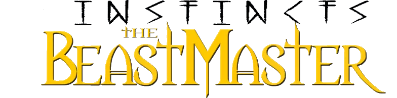

# Instincts 2026

Fixes and a native companion for **Instincts - Animal Taming in Skyrim** by Kheree (Nexus 63224), whose permissions allow modification.

| Folder | What it is |
|---|---|
| `Instincts-Fixes/` | Papyrus and plugin fixes for Instincts: third pet summoned, taming checked before the wild animal is destroyed, pet slots by strength, level gates, pets eat from their own inventory, training without the furniture seat. Decompiled originals are kept in `reference/`. |
| `Beast-Harmony/` | `BeastHarmony.dll` (SKSE, CommonLibSSE-NG) and `BeastHarmony.esp`: knock-out rule for taming dangerous animals, pet classes, jobs, danger alert, menu. GPL-3.0-or-later. |

Each folder has its own README with details. Both are untested by anyone but the author and are not published on Nexus.

Mod-manager-ready archives are built from these folders and kept outside the repository.
